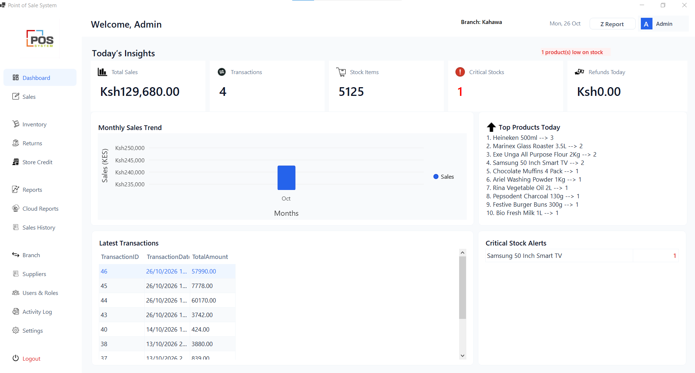
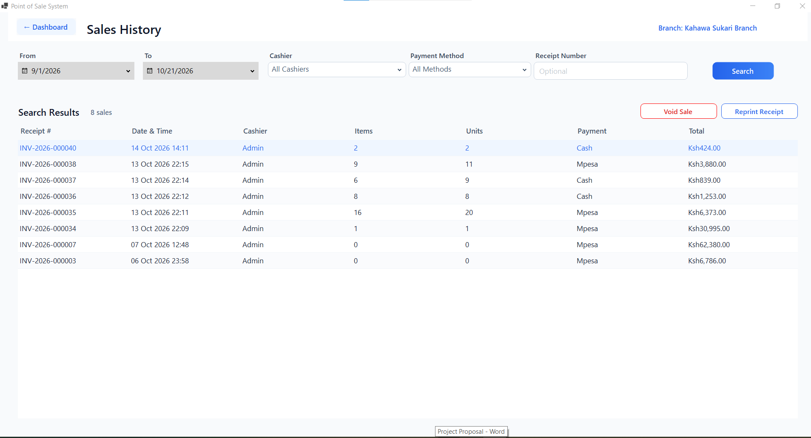
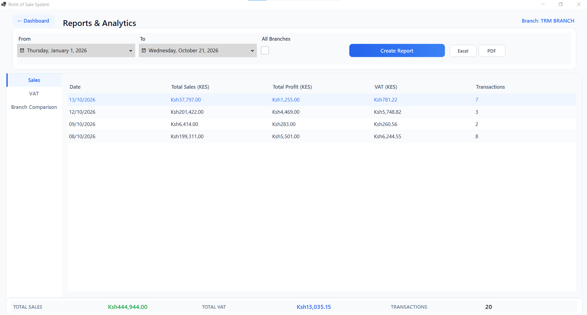

# Cloud-Enabled Intelligent POS System for SMEs

A Windows desktop Point of Sale (POS) system built for small and medium enterprises in Kenya. It supports multiple branches, role-based access, VAT-aware sales, returns, daily Z-reports, cloud reporting and integrated M-Pesa payments.

This is a final year project. It was built to work offline-first at each branch and sync to a shared cloud database for reporting.

## Screenshots

**Dashboard**

**Sales History**

**Reports**

## Features

- **Role-based access control:** Admin, Manager and Cashier roles, enforced in the service layer
- **Secure authentication:** BCrypt password hashing, login lockout and forced password change
- **Sales:** cart, tender, VAT calculation and receipt printing
- **Inventory:** stock tracking with an append-only stock movement log
- **Returns and refunds:** including store credit
- **Reports:** filters, charts and export to Excel and PDF
- **Z-reports:** write-once end-of-day reports per branch
- **Multi-branch and cloud reporting:** cross-branch reports from a shared cloud database
- **M-Pesa payments:** Safaricom Daraja STK Push with idempotent callback handling and a manual reference fallback
- **Audit log:** a record of sensitive actions

## Architecture

The desktop application uses a four-tier layered design:

| Tier | Responsibility |
|---|---|
| Presentation | Windows Forms pages and dashboard shell |
| Application | Services, business rules and role checks |
| Data Access | DAO classes, the only place SQL is written |
| Database | PostgreSQL, local per branch plus a shared cloud database |

The cloud sync service and the M-Pesa callback receiver run as separate components and are not part of this repository.

## Tech Stack

- C# 12 and .NET 8
- Windows Forms
- PostgreSQL with Npgsql
- BCrypt, iText7, ClosedXML, LiveCharts, DotNetEnv
- Safaricom Daraja API (Lipa na M-Pesa Online)

## Testing

The project was tested with 72 test cases across 10 modules (authentication, sales, inventory, returns, store credit, reports, users, cloud sync, audit log and M-Pesa). All 72 passed. M-Pesa was tested in the Daraja sandbox only, because no production shortcode was available.

## Limitations

- M-Pesa has not been tested with real money or production callbacks
- Deployment is manual
- Automated installer and updates
- KRA eTIMS integration

## Author

CWN221, Kenya.

## License

This project is licensed under the GNU Affero General Public License v3.0 (AGPL-3.0). See the [LICENSE](LICENSE) file for details.
